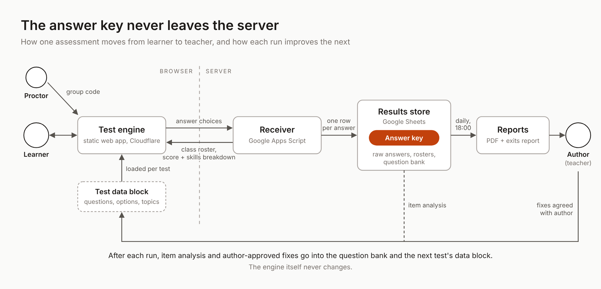

# Competency Assessment Engine (demo)

A browser-based engine for competency tests. I designed it as a Learning Experience Designer and built it with AI. It ran a school-wide assessment: 198 learners, 513 completed attempts, zero system failures, live 10 days after the first line of code. The answer key and the scoring stay on the server, so the code here can be public.

## For recruiters and hiring managers

You do not need to read code to evaluate this project.

1. Take the demo test. Clicking through the 10 questions takes about 5 minutes. A learner has 20 minutes, and a timer on the screen shows how much time is left.

   [Open the demo](https://anna123456778.github.io/competency-assessment-engine/public/demo.html)

   Guest code: `246810`. If the test locks after repeated exits from the page, enter the unlock code `517362`.

2. Read the case study. It covers the problem, the design decisions, the review process and the results of the first school-wide run.

   [From Ad-Hoc Tests to Trusted Learning Data](https://buttercup-objective-cfb.notion.site/From-Ad-Hoc-Tests-to-Trusted-Learning-Data-40ec63a2e16b815fbca0ea315d74a5a7)

3. Open `public/demo-data.js`. It contains every question of the demo test and none of the correct answers. The section "Where the answer key is" explains why.

## The demo test

"Using generative AI responsibly at work" has 10 questions about one person, Maya Collins, a civil servant who uses AI tools at work. It covers 5 skills and gives 20 points in total. Every wrong option is built on a specific misconception, so a wrong answer shows what exactly the learner misunderstands.

## What the system does

- One engine runs every test. A test is a separate data file with questions, options, skills and points, so adding a test does not change the engine.
- At the end the learner sees their level, the number of correct answers, the numbers of the questions they missed and a table of results by skill. Each skill is written in the first person ("I can...").
- Every answer is saved as a separate record. Any attempt can be traced and any question analysed.
- On the day of the test the person who runs it receives an automatic report by email. They get the report but no access to the data, which means results cannot be changed afterwards.
- A pause button for air-raid alerts in Ukraine. The attempt waits, and the learner continues after entering the group code.
- Every exit from the test page is logged with its type, time and duration. After every fifth exit the attempt locks until the person running the session enters an unlock code. The decision to annul an attempt is made by a person.

## Architecture



| Part | Runs on | Responsibility |
| --- | --- | --- |
| Engine | Browser, hosted on GitHub Pages | Shows questions, collects answers, handles the pause, full screen and exits |
| Test data file | Browser | Questions, options, skills and points, without correct answers |
| Receiver | Google Apps Script | Checks the group code, scores the attempt, writes records, builds reports |
| Data store | Google Sheets | Test register, answer keys, raw answers, attempts, exits |

## Where the answer key is

The correct answers and the scoring exist only in the Google Sheet on the server. If the key were in the page code, any learner could find it in the browser's developer tools.

You can check this yourself. The engine and `demo-data.js` contain the questions and the options, and no correct answers. The commit history of this repository does not contain them either.

## Adding a new test

A new test takes about 30 minutes to build.

1. The author writes the test from expected learning outcomes. Each question is linked to an outcome, and each outcome is checked by at least one question.
2. The questions, options, skills and points go into a new data file in the same format as `public/demo-data.js`.
3. The correct answers go into the sheet on the server.
4. The test is registered as inactive and without a time window.
5. A trial attempt runs in admin mode, where the report goes only to the admin. Every answer in the key is compared with the author's original.
6. The time window opens, and learners can take the test.

## Working with AI

I built the system with Claude. I made the product and learning decisions: levels instead of points, skills instead of topics, the integrity rules, how the air-raid pause works, what happens when a learner leaves the page, and the wording of every screen a learner sees. Claude wrote code from the logic I described, turned teachers' tests into data files, checked the answer keys for errors and ran the calculations.

Rules I set for Claude:

- the answer key and the scoring live only on the server;
- the engine is never rewritten for a test, each test gets only a data file;
- edits are targeted, a whole file is never regenerated;
- if a key is missing or unclear, ask instead of guessing;
- errors in a teacher's test are never fixed silently;
- no deploys on a test day;
- no access to the repository, every file reaches production through my manual upload.

This repository was built the same way: I uploaded every file by hand.

In 10 days the engine went through about 7 versions and the receiver through about 6. The first school-wide run took 52 group sessions.

## Repository structure

```
public/
  demo.html        entry page of the demo
  engine.js        the test engine
  engine.css       styles
  demo-data.js     data file of the demo test (no answer key)
  q3_evidence.png  image used in question 3
apps-script/
  Code.gs          Google Apps Script receiver
docs/
  architecture.png architecture diagram
```

## Author

Anna Dobrovolska, Learning Experience Designer

[Portfolio](https://bit.ly/anna-dobrovolska) · [LinkedIn](https://www.linkedin.com/in/anna-dobrovolska-08651a204)
